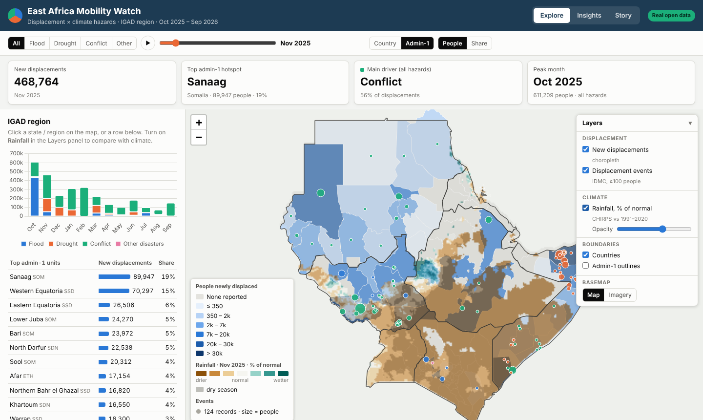

# East Africa Mobility Watch — Demo

An interactive web map of **disaster displacement by hazard** (flood, drought, conflict) across the eight IGAD member states, built to show an end-to-end geospatial workflow: a Python data pipeline, a Leaflet web map with charts, Docker packaging and CI/CD deployment to GitHub Pages.

> ⚠️ **Illustrative sample data.** The displacement figures are synthetic, generated with realistic seasonal patterns for demonstration. Replace `data/raw/displacement.csv` with a real export (e.g. IOM DTM or IDMC) to use real figures.

> 💼 **About my production work.** This repo is a public sample. My real production dashboards for Riyadh Municipality run on Netlify behind password protection, because they belong to my employer. I can demonstrate them live during an interview.

**Live demo:** https://aelsayied-create.github.io/east-africa-mobility-watch/



## Features
- Choropleth map of new displacements per country, with automatic class breaks and legend
- Filter by hazard; monthly time slider with play animation, or full-year view
- Click a country (or a table row) for its monthly trend, stacked by hazard
- Ranked country table and key figures that update with every filter
- Light / satellite imagery basemap switch
- Export of the current view to CSV
- Responsive layout for mobile

## Architecture
```
data/raw/                 source data (boundaries + displacement table)
scripts/build_data.py     Python pipeline: validate → aggregate → web-ready JSON/GeoJSON
web/                      static front end (Leaflet, Chart.js, vanilla JS)
Dockerfile                multi-stage build: pipeline, then nginx
netlify.toml              optional Netlify build (runs the pipeline, publishes web/)
.github/workflows/        CI/CD: pipeline + Docker build check + GitHub Pages deploy
```

## Run locally
```bash
python scripts/build_data.py
cd web && python -m http.server 8000      # open http://localhost:8000
```

Or with Docker:
```bash
docker build -t eamw-demo .
docker run -p 8080:80 eamw-demo           # open http://localhost:8080
```

## Deploy
- **GitHub Pages:** every push to `main` runs the pipeline, checks the Docker build and deploys `web/` (`.github/workflows/pages.yml`).
- **Netlify (alternative):** import the repo in Netlify; `netlify.toml` handles the build.

## Data sources
- Country boundaries: [Natural Earth](https://www.naturalearthdata.com/) (public domain), via `world-atlas`
- Basemaps: © OpenStreetMap contributors, © CARTO, Esri World Imagery
- Displacement: illustrative sample data (see note above)

## Roadmap
- Load real IOM DTM / IDMC data through their APIs
- Admin-1 level boundaries and PostGIS backend with a REST API
- Overlay hazard forecasts (e.g. flood outlooks) for anticipatory action

## Author
**Amna Abdein** — GIS Specialist & Geospatial Web Developer
